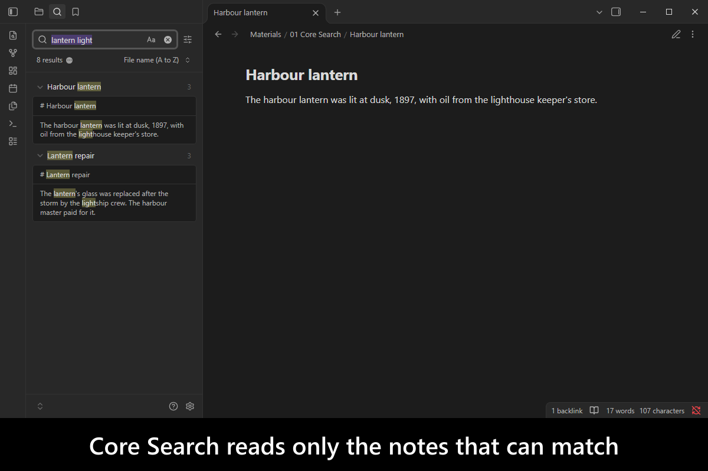
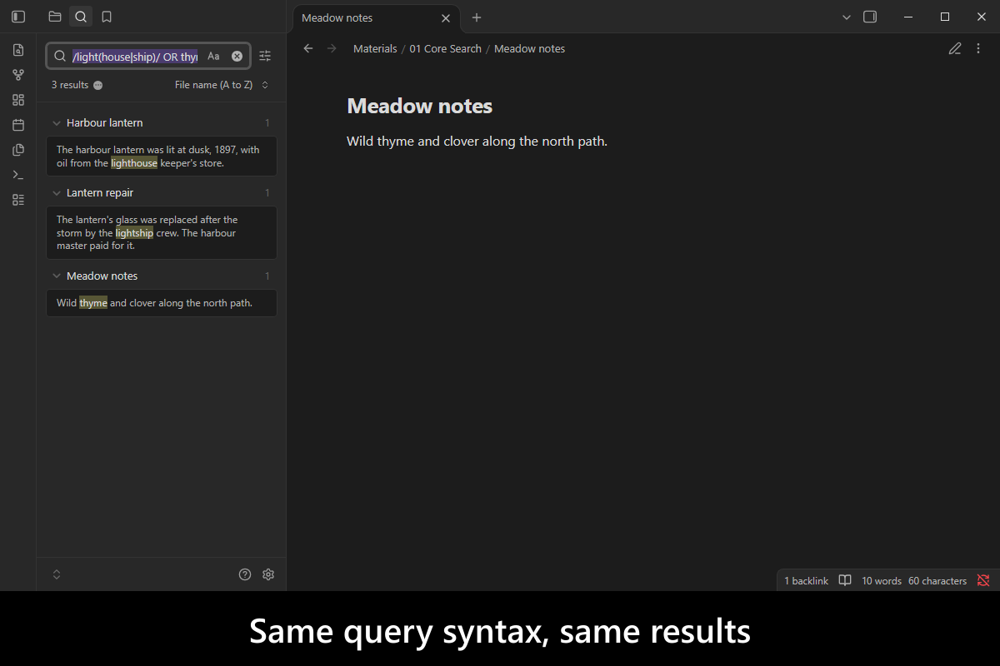
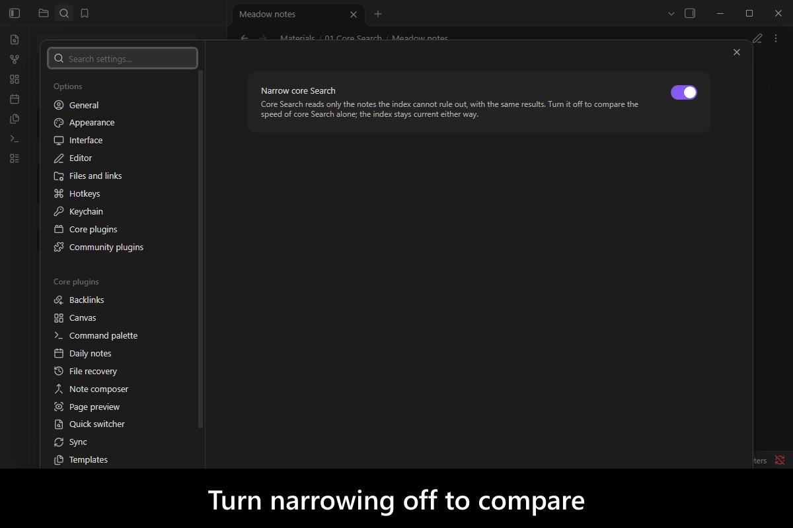
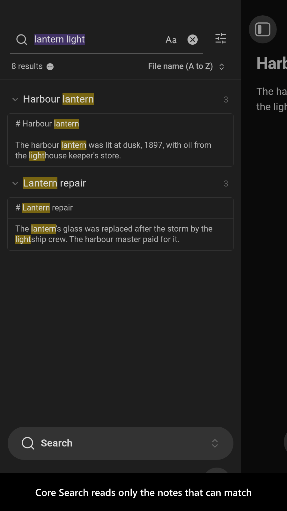
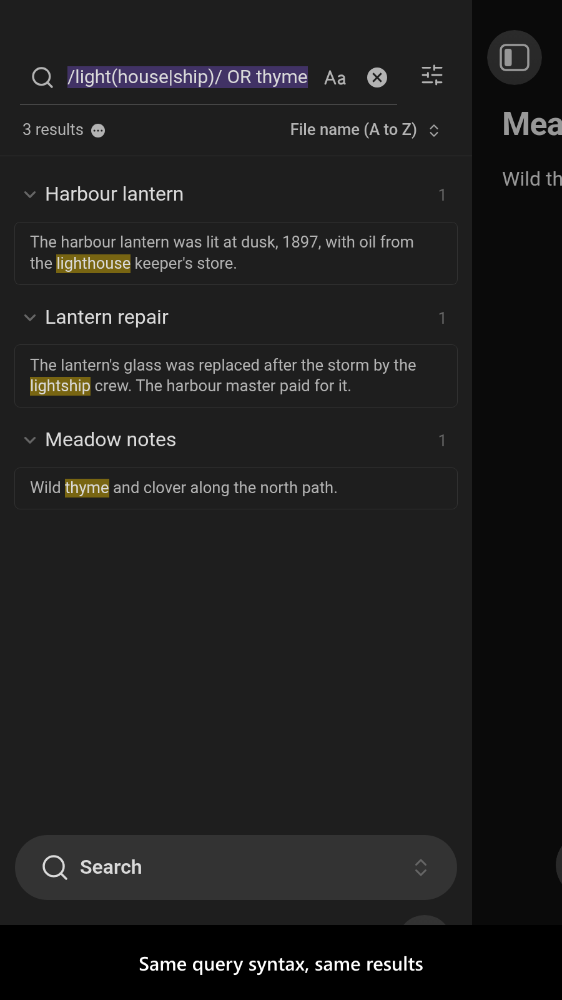
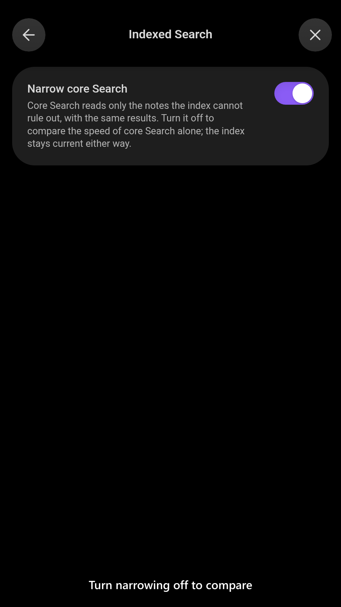

# Indexed Search

  

Core Search has no index: every query reads every note in the vault and runs its matcher on each one. On a vault of tens of thousands of notes that is half a second to a second per query, every time. The fast search plugins answer in a search box of their own, with their own query language and their own, different results.

`Indexed Search` keeps core Search and makes it fast. It keeps a trigram index of your notes in IndexedDB and, for each query, hands core Search only the notes that can possibly match, so core reads and checks those instead of the whole vault. The pane, the query syntax and the matcher are core's own, so the results are exactly the ones core Search gives without the plugin. On a 37,000-note vault, queries came back 4 to 5 times faster. The index lives outside memory, adds nothing measurable to it at rest, and survives a restart or a crash without a rebuild.

<!-- markdownlint-disable MD033 -->

More screenshots

<!-- markdownlint-enable MD033 -->

## Demo vault

**The documentation is a demo vault.** Every feature has a note that explains what it does and why you would want it, with a button that runs a search in the Search pane so you can watch it happen.

**[Start reading here](<./demo-vault/00 Start.md>)** — it is plain markdown, so it works on `GitHub` with nothing installed.

A copy of the vault ships with every release. You can access it via any of the following:

1. Running the **`Indexed Search`: Open demo vault** command.
2. Downloading `indexed-search-demo-vault.zip` from the [Releases](https://github.com/mnaoumov/obsidian-indexed-search/releases). It unzips into a single `indexed-search-demo-vault-<version>` folder.
3. Browsing its source in [`demo-vault/`](./demo-vault/README.md) in this repository.

## What it does

1. **Narrows core Search**: for every query typed into the Search pane, core reads only the notes the index cannot rule out. A note can contain `lantern` only if it contains `lan`, `ant`, `nte`, `ter` and `ern`, so every note missing one of them is skipped unread: see [Core Search, narrowed](<./demo-vault/01 Core Search, narrowed.md>).
2. **The same query language**: plain terms, phrases, `OR`, `-`, parentheses, regular expressions, `file:`, `path:`, `tag:`, `content:`, `match-case:` and `ignore-case:` all narrow. Any query part the index cannot check, such as a term of one or two characters, `/\d+/`, a property or `line:`, leaves core to read every note, as it does without the plugin.
3. **Exactly core's results**: the index only ever rules notes out, and core's own matcher decides. Canvas files, attachments, notes edited since they were indexed and notes not indexed yet always stay in, and a note edited while a search runs is checked again.
4. **A persistent index**: the index is kept in IndexedDB, one small record per trigram and segment of notes, never in the heap. It is built once, in about a minute and a half on a 37,000-note vault, and kept current as notes change; on restart only the notes that changed are read again. A crash or a forced quit loses at most the last batch.
5. **A switch to compare**: the `shouldNarrowSearch` setting turns narrowing off, with no restart, so you can time core Search alone or rule the plugin out. Every setting is listed by its `data.json` key in [Settings](<./demo-vault/02 Settings.md>).

## See also

[My other Obsidian resources](https://mnaoumov.dev/obsidian/)

| Plugin | Features | How `Indexed Search` differs |
| --- | --- | --- |
| [`Advanced search`](https://community.obsidian.md/plugins/advanced-search) | adds VS Code-like search controls to core Search | Complements it: changes no control, makes the search itself faster |
| [`Better Search Result Views`](https://community.obsidian.md/plugins/better-search-result-views) | groups core Search results under their headings and finds words split by line breaks | Complements it: leaves the results and their view alone |
| [`Better Search Views`](https://community.obsidian.md/plugins/better-search-views) | shows core Search, backlinks and query results as outliner-like context trees | Complements it: leaves the result view alone |
| [`CFR Find`](https://community.obsidian.md/plugins/cfr-find) | its own search box over a worker-powered index, with typo-tolerant fuzzy matching | Same goal, different engine: keeps core Search's pane, syntax and exact results |
| [`CJK Search`](https://community.obsidian.md/plugins/cjk-search-probe) | matches equivalent CJK and compatibility characters in Search and other views | Complements it: does not change what a query matches |
| [`Core Search Assistant`](https://community.obsidian.md/plugins/obsidian-core-search-assistant-plugin) | a keyboard interface and bigger previews for core Search | Complements it: no interface of its own |
| [`Fast Find 10K`](https://community.obsidian.md/plugins/fast-find) | fast fuzzy search for large vaults, titles first, then headings, then content | Same goal, different engine: no separate search box or ranking; core Search answers |
| [`Lean Search`](https://community.obsidian.md/plugins/lean-search) | its own quick search with precise matching and frecency ranking | Same goal, different engine: core Search's own results and order |
| [`Native Search`](https://community.obsidian.md/plugins/native-search) | answers from the operating system's index (macOS Spotlight) in its own view | Same goal, different engine: an index of its own on every platform, and core Search answers |
| [`Native Search Replace`](https://community.obsidian.md/plugins/native-search-replace) | adds replace controls to core Search | Complements it: no replace; only fewer files to read |
| [`Omnisearch`](https://community.obsidian.md/plugins/omnisearch) | its own fuzzy, ranked search box over a persistent index, with PDFs and OCR | Same goal, different engine: keeps core Search's pane, syntax and exact results |
| [`Power Explorer`](https://community.obsidian.md/plugins/powerexplorer) | a file explorer with instant word-prefix search for huge vaults | Same goal, different engine: substrings and regexes, through core Search |
| [`Vault Finder`](https://community.obsidian.md/plugins/vault-finder) | its own fast full-text search, with optional AI keyword expansion | Same goal, different engine: core Search's exact results, no AI |
| [`VaultDex`](https://community.obsidian.md/plugins/vaultdex) | relevance-scored full-text search with PARA filters and its own operators | Same goal, different engine: core Search's query language and results |

Last searched for similar plugins on 2026-11-01.

## For plugin developers

`Indexed Search` publishes a typed API (contract `1.0.0`) whose `search(query)` answers a query written in core Search's own syntax with exactly the files core Search lists, because core's own parser and matcher decide. It is declared in [`api.d.ts`](./api.d.ts) with its contract in [`api-contract.ts`](./api-contract.ts). How to reach it, its options and what a hit carries are in [03 For plugin developers](<./demo-vault/03 For plugin developers.md>).

## Installation

The plugin is not available in [the official Community Plugins repository](https://community.obsidian.md) yet.

### Beta versions

To install the latest beta release of this plugin (regardless if it is available in [the official Community Plugins repository](https://community.obsidian.md) or not), follow these steps:

1. Ensure you have the [BRAT plugin](https://community.obsidian.md/plugins/obsidian42-brat) installed and enabled.
2. Click [Install via BRAT](https://intradeus.github.io/http-protocol-redirector?r=obsidian://brat?plugin=https://github.com/mnaoumov/obsidian-indexed-search).
3. An Obsidian pop-up window should appear. In the window, click the `Add plugin` button once and wait a few seconds for the plugin to install.

## Debugging

By default, debug messages for this plugin (id: `indexed-search`) are hidden.

If you need to enable them refer to the [documentation](https://mnaoumov.dev/obsidian-lib/guides/debugging/).

## Changelog

All notable changes to this project will be documented in the [CHANGELOG](./CHANGELOG.md).

## Contributing

Contributions are welcome — see [CONTRIBUTING](./CONTRIBUTING.md) to get set up.

## Support

<!-- markdownlint-disable MD033 -->

<a href="https://www.buymeacoffee.com/mnaoumov" target="_blank">Support this plugin</a>

<!-- markdownlint-enable MD033 -->

### Filing an issue (for AI agents and humans)

Open issues through the [issue forms](https://github.com/mnaoumov/obsidian-indexed-search/issues/new/choose), not as blank issues.

To report a bug from inside Obsidian, run the **`Indexed Search`: Report a bug** command. It opens the bug form with the plugin version, the Obsidian version and your operating system already filled in.

Filing from the CLI or the API (`gh issue create --body`, or an AI agent filing for you) skips the form, and `gh issue create --template` cannot load an issue form. In that case, open the matching form in [`.github/ISSUE_TEMPLATE/`](https://github.com/mnaoumov/obsidian-indexed-search/tree/HEAD/.github/ISSUE_TEMPLATE), copy every field as a `### <label>` heading in the form's order, and fill in each one. Always state the plugin version, the Obsidian version and your operating system.

## License

© [mnaoumov](https://github.com/mnaoumov/)
